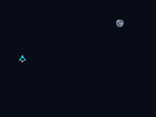
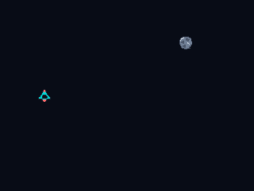
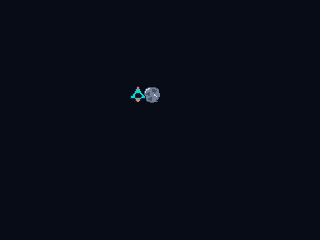
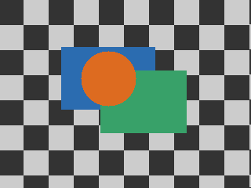
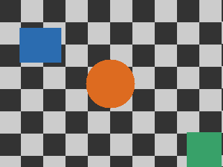
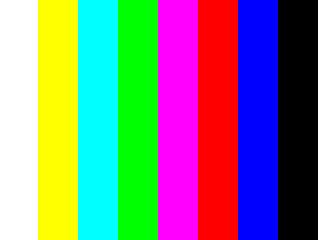
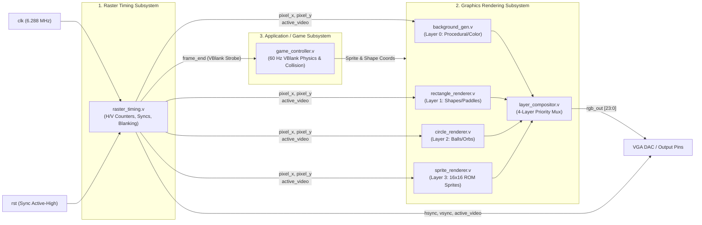

# FPGA-Based 2D Graphics Engine


A modular, high-performance 2D raster graphics engine and interactive retro space evasion game engineered from scratch in synthesizable Verilog HDL (Verilog-2001). The engine performs **real-time on-the-fly coordinate rendering** (requiring no external framebuffer) and features an interactive desktop co-simulation environment for live keyboard gameplay.

---

## Visual Gallery

All visual output is rendered cycle-by-cycle directly from synthesizable Verilog logic during raster scanning:

| Full System (Top Level) | Gameplay (Spacecraft & Asteroid) | Collision & Game-Over |
| :---: | :---: | :---: |
|  |  |  |
| **Complete Chip Output** | **Asteroid Motion & Evasion** | **Hardware AABB Collision** |

| Multi-Layer Compositing | Geometric Primitives | Color Bars Test Pattern |
| :---: | :---: | :---: |
|  |  |  |
| **4-Layer Priority Multiplexing** | **Rectangles & Circles** | **Procedural Background** |

---

## Key Technical Specifications

* **Target Resolution**: 320 × 240 active visible pixels.
* **Target Refresh Rate**: 60.00 FPS nominal.
* **Pixel Clock**: 6.288 MHz ($400 \times 262$ cycles per frame = 104,800 cycles/frame).
* **Color Depth**: RGB888 (24-bit true color: 8 bits Red, 8 bits Green, 8 bits Blue).
* **Sync Signals**: Standard active-low horizontal (`hsync`) and vertical (`vsync`) synchronization.
* **Rendering Architecture**: On-the-fly raster scanning (no external framebuffer needed, saving $\sim 230\text{ KB}$ of RAM).
* **Layer Compositor**: 4-layer fixed priority pipeline with 1-bit transparency masking:
  $$\text{Layer 3 (Sprite)} > \text{Layer 2 (Circle)} > \text{Layer 1 (Rectangle)} > \text{Layer 0 (Background)}$$
* **Collision Detection**: Real-time cycle-accurate Axis-Aligned Bounding Box (AABB) hardware intersection.

---

## System Architecture

The engine is decoupled into three independent domains:



---

## Interactive Hardware Play (Co-Simulation)

You can play the hardware-implemented game directly on your workstation! The Python co-simulation harness bridges your keyboard inputs via stdin into the running Icarus Verilog simulation and captures raw binary video frames to a 60 FPS retro window:

```powershell
# Launch the interactive game
python scripts/play_game.py
```

### Controls:
* **Arrow Keys / WASD**: Steer Spacecraft in real-time
* **R**: Restart Game after collision
* **ESC**: Exit

---

## Automated Regression Testing

To run the complete automated test suite across all 8 unit and integration testbenches:

```powershell
python scripts/run_all_tests.py
```

### Verification Matrix

| Testbench | Module Under Test | Scope & Verification Criteria | Status |
| :--- | :--- | :--- | :--- |
| `tb/unit/tb_smoke.v` | Toolchain Verification | Basic compilation, VVP execution, VCD dumping | **PASSED** |
| `tb/unit/tb_raster_timing.v` | `raster_timing.v` | Exact 400 clocks/line, 262 lines/frame, sync pulses, zero errors | **PASSED** |
| `tb/unit/tb_background.v` | `background_gen.v` | Solid, Color Bars, Checkerboard, Gradient patterns | **PASSED** |
| `tb/unit/tb_primitives.v` | `rectangle_renderer.v`, `circle_renderer.v` | Inclusion/exclusion boundaries, edge clipping | **PASSED** |
| `tb/unit/tb_compositor.v` | `layer_compositor.v` | Full 8-state priority matrix, 1-bit transparency masking | **PASSED** |
| `tb/unit/tb_sprite.v` | `sprite_renderer.v` | 16×16 2-bit indexed ROM lookup, color palette mapping | **PASSED** |
| `tb/integration/tb_game.v` | `game_controller.v` | 60 Hz VBlank physics, asteroid reflection, AABB collision latch | **PASSED** |
| `tb/integration/tb_graphics_system.v` | `simulation_top.v` | Full-chip top-level integration frame capture (76,800 pixels) | **PASSED** |

---

## Repository Structure

```text
fpga-2d-graphics-engine/
├── assets/                 # Graphics assets and ROM source files
│   └── sprites/
├── docs/                   # Architectural decisions and specifications
│   ├── architecture.md     # Detailed subsystem architecture & timing diagrams
│   ├── decisions.md        # Architecture Decision Records (ADR-001 through ADR-005)
│   ├── progress.md         # Milestone progress tracker
│   ├── specification.md    # Hardware timing, polarities, and video profile
│   ├── verification.md     # Testbench verification plan and test matrix
│   └── images/             # Rendered showcase frames
├── rtl/                    # Synthesizable Verilog HDL source code
│   ├── game/               # Application & game physics (game_controller.v)
│   ├── graphics/           # Primitives, background, sprites, and compositor
│   ├── top/                # Full-system top-level wrapper (simulation_top.v)
│   └── video/              # Raster timing generator (raster_timing.v)
├── scripts/                # Verification and interactive tooling
│   ├── play_game.py        # Desktop arcade hardware co-simulation
│   ├── ppm_to_png.py       # PPM raster frame to PNG converter
│   └── run_all_tests.py    # Automated regression test runner
├── sim/                    # Simulation outputs and wave dumps
│   ├── output/             # Generated test frame dumps (.gitkeep)
│   └── waveforms/          # VCD waveform dumps for GTKWave (.gitkeep)
└── tb/                     # Verification testbenches
    ├── integration/        # Full-system, game, and interactive testbenches
    └── unit/               # Unit testbenches for individual RTL modules
```

---

## Toolchain & Requirements

* **HDL Standard**: Verilog-2001 (`-g2001`)
* **Simulator**: [Icarus Verilog](https://bleyer.org/icarus/) (v12.0+)
* **Waveform Viewer**: [GTKWave](http://gtkwave.sourceforge.net/)
* **Runtime**: Python 3.8+ with `Pillow` (`pip install pillow`)
* **Operating System**: Windows 10/11, Linux, or macOS
