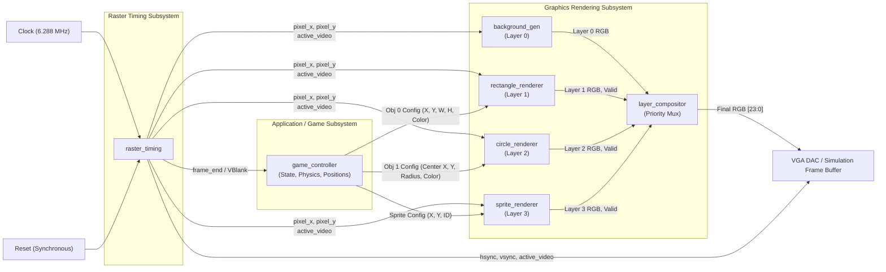

# System Architecture: FPGA 2D Graphics Engine

**Revision**: 1.0  
**Target Platform**: Synthesizable FPGA / Verilog-2001

---

## 1. Top-Level Architectural Decomposition

The graphics engine strictly separates raster generation, pixel rendering/compositing, and application/game state logic into three decoupled domains.

---

## 2. Subsystem Responsibilities

### 2.1 Raster Timing Subsystem (`rtl/video/raster_timing.v`)
* **Horizontal Counter (`h_count`)**: 9-bit counter, counts $0 \dots 399$.
* **Vertical Counter (`v_count`)**: 9-bit counter, counts $0 \dots 261$.
* **HSYNC Generator**: Active-low pulse when $h\_count \in [336, 383]$.
* **VSYNC Generator**: Active-low pulse when $v\_count \in [250, 251]$.
* **Active Video Generator**: High during visible display window ($X < 320 \land Y < 240$).
* **Strobes**: `line_start`, `frame_start`, `frame_end` (VBlank notification).

### 2.2 Graphics Rendering Subsystem (`rtl/graphics/`)
* **`background_gen`**: Generates default background color or procedural patterns (checkerboard, bars) when no foreground layer is active.
* **Primitive Renderers (`rectangle_renderer`, `circle_renderer`)**: Test whether current `(pixel_x, pixel_y)` satisfies geometric inclusion criteria. Outputs 24-bit color and 1-bit `valid` flag.
* **`layer_compositor`**: Evaluates active layers according to fixed priority order:
  $$\text{Pixel Color} = \begin{cases}
  \text{Layer 3 Color} & \text{if } \text{Layer 3 Valid} \\
  \text{Layer 2 Color} & \text{else if } \text{Layer 2 Valid} \\
  \text{Layer 1 Color} & \text{else if } \text{Layer 1 Valid} \\
  \text{Layer 0 Color} & \text{otherwise (Background)}
  \end{cases}$$
* Blanking clamping ensures that when `active_video == 0`, final RGB is forced to pure black (`24'h000000`).

### 2.3 Application / Game Subsystem (`rtl/game/`)
* Runs at the frame boundary, triggered by `frame_end` (vertical blanking interval).
* Computes object motion vectors, boundaries, inputs, and collisions.
* Drives configuration registers (coordinates, sizes, colors) of the renderers without coupling directly to the pixel rendering pipeline.
